## Лабораторна 01: проєктування баз даних для мікросервісної архітектури (EstateHub)

### 1. Предметна область

Платформа для пошуку та реалізації нерухомості. Автоматизує процеси оренди та продажу житла і взаємодію трьох типів користувачів: **власників** (розміщують оголошення), **клієнтів** (шукають об'єкти, залишають заявки) і **рієлторів** (супроводжують угоду).

Систему розділено на три ізольовані bounded contexts, кожен — своя база даних, без FOREIGN KEY між базами.

| # | Контекст | База даних | Основні сутності/колекції |
|---|---|---|---|
| 1 | Каталог нерухомості (Property Catalog) | SQL Server + EF Core (Проєкт №2) | Property, Category, Amenity, PropertyImage, PropertyLocation |
| 2 | Заявки та угоди (Applications & Transactions) | SQL Server + ADO.NET & Dapper (Проєкт №1) | Application, Viewing, Contract, Realtor |
| 3 | Комунікація та активність (Activity & Communication) | MongoDB (Проєкт №3) | Favorites, Reviews, Inquiries |

ERD-діаграми: [`docs/erd-project1.png`](docs/erd-project1.png) (Проєкт №1), [`docs/erd-project2.png`](docs/erd-project2.png) (Проєкт №2).

### 2. Політика дублювання даних та узгодженості (Eventual Consistency)

Між базами немає JOIN-ів і FOREIGN KEY, тому частина полів свідомо дублюється.

| Поле | Де зберігається | Джерело (власник) | Політика узгодженості |
|---|---|---|---|
| `Applications.PropertyId`, `PriceSnapshot`, `PropertyTitleSnapshot` | БД Угод (Проєкт №1) | `Property` (БД Каталогу) | Знімок на момент подання заявки — **не оновлюється** (аналог `OrderItem.ProductName/UnitPrice` в eShop) |
| `Favorites/Reviews/Inquiries.propertyId`, `propertyTitle`, `city` | БД Активності (MongoDB, Проєкт №3) | `Property` (БД Каталогу) | Копія для читання — оновлюється подією `PropertyUpdatedEvent` |
| `Properties.Status = 'sold'` | БД Каталогу (Проєкт №2) | Угода (БД Угод) | Оновлюється подією `PropertySoldEvent` з Проєкту №1 |

Жодне з цих полів не має FOREIGN KEY на іншу базу — цілісність посилання перевіряє прикладний код.

### 3. Розгортання з нуля

#### Проєкт №1 — SQL Server + Dapper (`db/p1/`)

```powershell
# 1. Створити базу
sqlcmd -S localhost -Q "CREATE DATABASE EstateHub_Transactions"

# 2. Схема (таблиці, ключі, обмеження, індекси)
sqlcmd -S localhost -d EstateHub_Transactions -i db/p1/schema.sql

# 3. Збережувані процедури
sqlcmd -S localhost -d EstateHub_Transactions -i db/p1/procedures.sql

# 4. Тестові дані (ідемпотентно — повторний запуск не дублює)
sqlcmd -S localhost -d EstateHub_Transactions -i db/p1/seed.sql
```

#### Проєкт №2 — SQL Server + EF Core (`db/p2/`)

```powershell
# Варіант 1: готовий SQL
sqlcmd -S localhost -Q "CREATE DATABASE EstateHub_Catalog"
sqlcmd -S localhost -d EstateHub_Catalog -i db/p2/schema.sql
sqlcmd -S localhost -d EstateHub_Catalog -i db/p2/seed.sql

# Варіант 2: міграціями EF Core (сервіс Catalog з Лаб. 03, див. розділ «Лаб. 03» нижче)
dotnet ef database update --project Services/Catalog/Catalog.Dal --startup-project Services/Catalog/Catalog.Api
```

Історичні міграції Лаб. 01 (проєкт `Lab1_Project2`, у порядку застосування):
1. `InitialCreate_AddPropertyLocationTable` — базова схема + таблиця `PropertyLocations`, довідникові seed-дані (Категорії, Зручності)
2. `AddAddedAtToPropertyAmenities` — власне поле `AddedAt` у проміжній таблиці `PropertyAmenities`

#### Проєкт №3 — MongoDB (`db/p3/`)

```powershell
# 1. Запустити mongod (якщо ще не запущено)
mongod --dbpath D:\Databases\data

# 2. В окремому терміналі — створити колекції з валідацією схеми
mongosh < db/p3/collections.js

# 3. Наповнити тестовими даними (ідемпотентно)
mongosh < db/p3/seed.js
```

### 4. Перевірка після розгортання

```sql
-- Немає FK за межі своєї бази (виконати в кожній SQL-базі)
SELECT * FROM sys.foreign_keys;

-- Перевірка CHECK-обмеження (має впасти з помилкою)
INSERT INTO Properties (..., Price, ...) VALUES (..., -100, ...);

-- Перевірка UNIQUE на Contracts.ApplicationId (друга спроба має впасти)
INSERT INTO Contracts (ApplicationId, ...) VALUES (@existingAppId, ...);
```

```javascript
// MongoDB: документи різної структури в одній колекції
db.Inquiries.find().pretty()   // type: question / viewing_request / offer — різні набори полів

// Перевірка індексів
db.Inquiries.getIndexes()
```

Повторний запуск будь-якого `seed.sql` / `seed.js` **не створює дублікатів** (перевірка `IF NOT EXISTS` / `find-or-create` перед вставкою).

### 5. Структура репозиторію

```
.
├── README.md
├── docs/
│   ├── erd-project1.png
│   ├── erd-project2.png
│   └── 01-swagger.png … (знімки екрана Лаб. 03)
├── db/
│   ├── p1/   schema.sql · procedures.sql · seed.sql
│   ├── p2/   schema.sql · seed.sql · migration.sql (Лаб. 03)
│   └── p3/   collections.js · seed.js
├── Platform.slnx · Platform.AppHost/
└── Services/   Deals (Лаб. 02) · Catalog (Лаб. 03)
```


## Лабораторна 02: сервіс заявок та угод (ADO.NET + Dapper)

Сервіс `Services/Deals` працює з БД `EstateHub_Transactions` (Проєкт №1 з Лаб. 01) і складається з шарів
`Deals.Api` → `Deals.Bll` → `Deals.Dal` (+ `Deals.Domain`).

| Шар | Що містить |
|---|---|
| Deals.Domain | моделі (Application, Viewing, Contract, Realtor, ApplicationRealtor), доменні винятки, інтерфейси репозиторіїв, `IGenericRepository<T>`, `IUnitOfWork` |
| Deals.Dal | `ApplicationRepository` (чистий ADO.NET), `ViewingRepository`/`ContractRepository`/`RealtorRepository` (Dapper, база `BaseDapperRepository<T>`), `UnitOfWork` з одним з'єднанням і транзакцією |
| Deals.Bll | сервіси, DTO (DataAnnotations), профілі AutoMapper, `Caching/CachedRealtorService` |
| Deals.Api | тонкі async-контролери, Swagger, `GlobalExceptionHandler` (ProblemDetails) |

### Запуск через Aspire
1. Встановіть .NET SDK та Docker Desktop.
2. `dotnet run --project Platform.AppHost`
3. У Aspire Dashboard (посилання в консолі) відкрийте ресурс `deals-api` → `/swagger`.
4. Виконайте `db/p1/schema.sql` (сам створює БД `EstateHub_Transactions`), потім `procedures.sql` і `seed.sql`
   (для контейнера: порт SQL Server видно в Dashboard, логін `sa`, пароль - параметр `sql-password` ресурсу).

### Запуск без Docker (LocalDB)
1. Виконайте `db/p1/schema.sql`, `procedures.sql`, `seed.sql` у `(localdb)\MSSQLLocalDB`.
2. `dotnet run --project Services/Deals/Deals.Api` → `https://localhost:<port>/swagger`.

### Приклади запитів
```http
POST /api/realtors
{"fullName":"Іван Петренко","email":"ivan@estatehub.com","phone":"+380501234567"}

POST /api/applications
{"clientId":"<guid>","propertyId":"<guid>","priceSnapshot":125000,"propertyTitleSnapshot":"2-кімн. квартира, центр"}

POST /api/applications/{id}/realtors          (M:N)
{"realtorId":"<guid>","role":"listing_agent"}

POST /api/applications/{id}/approve           (транзакція: статус + огляд)
{"rowVersion":"<base64 з відповіді>","realtorId":"<guid>","viewingDate":"2027-01-15T10:00:00Z"}

POST /api/applications/{id}/contract          (транзакція: договір + completed)
{"rowVersion":"<base64>","finalPrice":120000}

PATCH /api/applications/{id}/status           (completed -> new = 409 ProblemDetails)
{"status":"new","rowVersion":"<base64>"}

GET /api/applications?page=1&pageSize=10&status=new
```
Помилки повертаються у форматі ProblemDetails: 400 (валідація), 404 (не знайдено), 409 (конфлікт: недопустимий
перехід статусу, застарілий RowVersion, дублікат).

## Лаб. 03 — Catalog (ASP.NET, тришарова архітектура, EF Core Code-First)

Мікросервіс **Catalog** (Проєкт №2, БД `EstateHub_Catalog_EF`): `Services/Catalog/` — `Catalog.Domain`, `Catalog.Dal`, `Catalog.Bll`, `Catalog.Api`, `Catalog.Tests`.

### Запуск
1. Встановіть SQL Server (LocalDB / Express) і .NET 10 SDK.
2. У `Services/Catalog/Catalog.Api/appsettings.json` змініть `ConnectionStrings:CatalogDb` на свій сервер
   (за замовчуванням LocalDB з `AttachDbFileName=C:\Users\Public\EstateHub_Catalog_EF.mdf`).
3. `dotnet run --project Services/Catalog/Catalog.Api`, Swagger: http://localhost:5200/swagger
   (у Development міграції застосовуються і сідінг виконується автоматично; у Production вимкнено).

### Міграції
```bash
dotnet tool install --global dotnet-ef
dotnet ef migrations add InitialCreate --project Services/Catalog/Catalog.Dal --startup-project Services/Catalog/Catalog.Api
dotnet ef database update --project Services/Catalog/Catalog.Dal --startup-project Services/Catalog/Catalog.Api
dotnet ef migrations script --project Services/Catalog/Catalog.Dal --startup-project Services/Catalog/Catalog.Api -o db/p2/migration.sql
```
Міграції: `Services/Catalog/Catalog.Dal/Migrations/`. Готовий SQL-скрипт: `db/p2/migration.sql`.

### Ключові рішення
- Зв'язки: 1:1 Property–PropertyLocation, 1:N Category→Property та Property→PropertyImage, M:N Property–Amenity через явну сутність `PropertyAmenity` з полем `AddedAt`.
- Репозиторії: Eager (`GetWithDetailsAsync`, 1 SQL), Explicit (`GetWithPropertiesAsync`, 2 SQL), LINQ через M:N (`GetRecentlyAddedAsync`); Unit of Work з єдиним `SaveChangesAsync`.
- Пагінація, фільтрація й сортування виконуються в SQL (Specification pattern, Ardalis); `pageSize` обмежено 1..100.
- Валідація: DataAnnotations + FluentValidation (явний виклик), відповідь `ValidationProblemDetails`.
- Помилки: глобальний `IExceptionHandler` + ProblemDetails (404, 400, 409, 500).
- Логи: Serilog зі структурованими властивостями `CorrelationId`, `UserId`, `RequestPath`; SQL-запити EF логуються.

### Основні ендпойнти
| Метод | URL | Коди |
|---|---|---|
| GET | `/api/Properties?page=1&pageSize=5&city=Київ&sortBy=price&sortDir=asc` | 200, 400 |
| GET | `/api/Properties/{id}` (eager) | 200, 404 |
| POST | `/api/Properties` | 201 + Location, 400, 404, 409 |
| PUT | `/api/Properties/{id}`, `/price`, `/status` | 204, 400, 404, 409 |
| DELETE | `/api/Properties/{id}` (м'яке видалення) | 204, 404 |
| GET | `/api/Categories/{id}/properties` (explicit) | 200, 404 |
| GET | `/api/Properties/by-amenity?amenity=Паркінг&since=2020-01-01` | 200, 400 |

Знімки екрана: `docs/` (Swagger, пагінація, 400, 409, 404, логи SQL для eager і explicit).

Лаб. 04: Reviews, Clean Architecture + CQRS (MediatR) + MongoDB
Мікросервіс Reviews (Проєкт 3 з Лаб. 1) розділено на 4 шари за принципом Clean Architecture. Залежності спрямовані лише всередину.
```
Reviews.WebApi  ──►  Reviews.Application  ──►  Reviews.Domain
      │                      ▲
      └─► Reviews.Infrastructure ─┘  (реалізує інтерфейси Application/Domain)
```
Шар	Відповідальність	Залежить від
`Services/Reviews/Reviews.Domain`	Сутності (`Review`, `Comment`), Value Objects (`Author`, `Criteria`), винятки, `IReviewRepository`	лише `MongoDB.Bson` (ObjectId)
`Services/Reviews/Reviews.Application`	CQRS-команди/запити (MediatR), валідатори (FluentValidation), Pipeline Behaviors, AutoMapper, `IReviewQueries`, `Caching/`	Domain
`Services/Reviews/Reviews.Infrastructure`	MongoDB: `BsonClassMap`, репозиторій, читання (проєкції/агрегації), seed, автоматичні індекси	Application, Domain
`Services/Reviews/Reviews.WebApi`	Тонкий контролер (`ISender`), `GlobalExceptionHandler` (ProblemDetails), Swagger	Application, Infrastructure (лише DI)
CQRS
Команди (змінюють стан): `CreateReviewCommand`, `UpdateReviewCommand`, `AddCommentCommand`, `DeleteReviewCommand`.
Запити (читають): `GetReviewByIdQuery`, `GetReviewsListQuery` (фільтри `productId`, `minRating`, `search`, пагінація).
Pipeline: `LoggingBehavior` → `ValidationBehavior` → `PerformanceBehavior` → handler. Якщо валідація не пройшла, handler не викликається (видно в логах).
MongoDB
База `ReviewsDb`, колекція `reviews`. Відображення через `BsonClassMap` (без атрибутів у Domain), `author` і `criteria` вбудовані документи, `comments` масив.
Оптимістична конкурентність: поле `version`, `ReplaceOne` з фільтром за версією; при розбіжності `409 Conflict`.
Індекси (створюються автоматично при старті): `ix_product_createdAt` (productId ↑, createdAt ↓), `ix_text` (text), `ux_product_author` (унікальний productId + author.userId).
Seed ідемпотентний: виконується лише якщо колекція порожня.
Зв'язок з Лаб. 1 (`EstateHub_Activity.Reviews`, `db/p3`): ті самі поля за змістом (об'єкт, автор, rating 1..5, text, criteria, comments, дати). У Лаб. 4 ідентифікатор `ObjectId`, а `author` це вбудований Value Object; окрема БД `ReviewsDb`, тому строга схема Лаб. 1 не конфліктує.
Коди відповідей
Ситуація	Код
Помилка валідації / бізнес-правила	400 (ProblemDetails з переліком помилок)
Відгук не знайдено	404
Конфлікт версій, дублікат (унікальний індекс)	409
MongoDB недоступна	503
Запуск
Запустіть MongoDB: `docker run -d --name mongo -p 27017:27017 mongo:7` (або локальний `mongod`).
`dotnet build Platform.slnx`
`dotnet test Services/Reviews/Reviews.Tests`
`dotnet run --project Services/Reviews/Reviews.WebApi` і відкрити `http://localhost:5300/swagger`.
Перевірка індексів у mongosh: `use ReviewsDb` → `db.reviews.getIndexes()`.

### Скріншоти
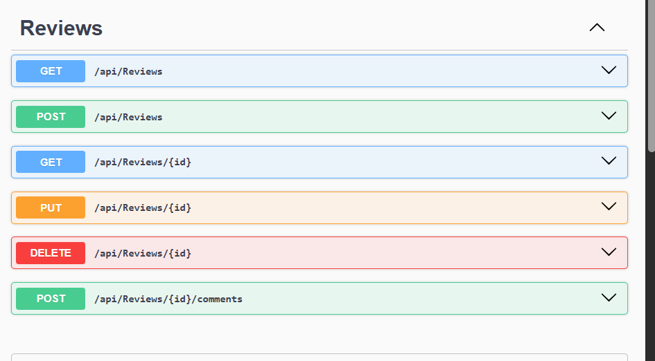
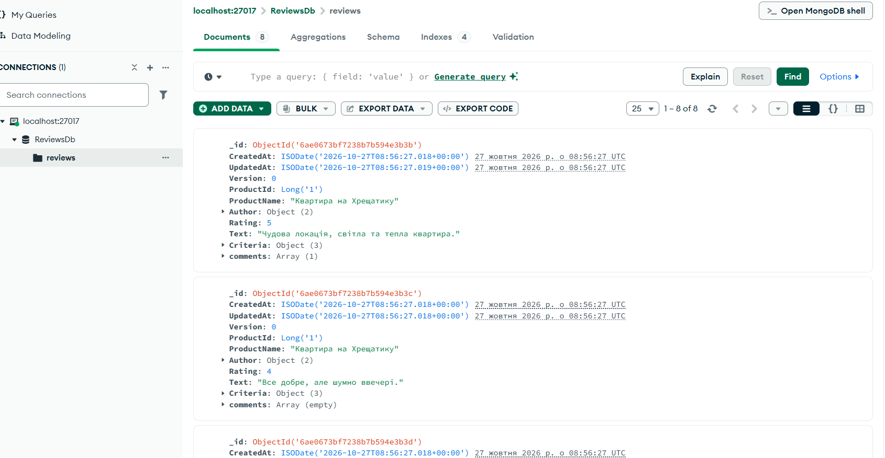
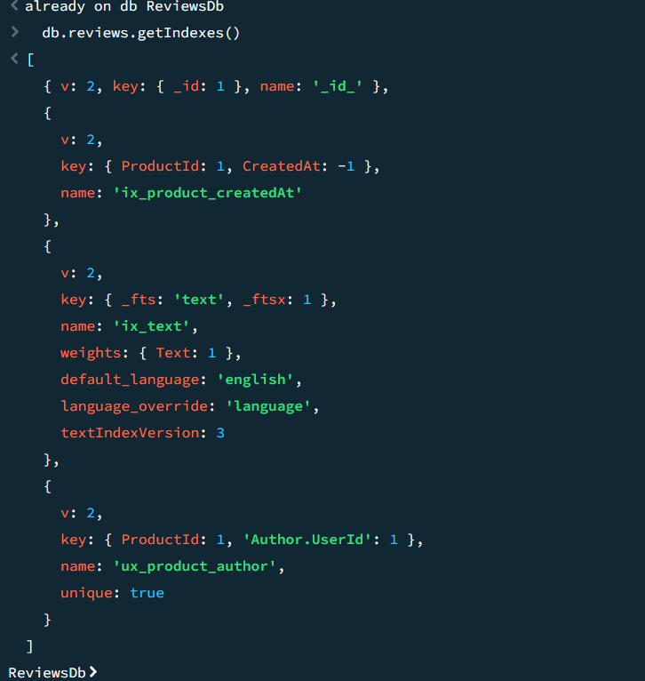
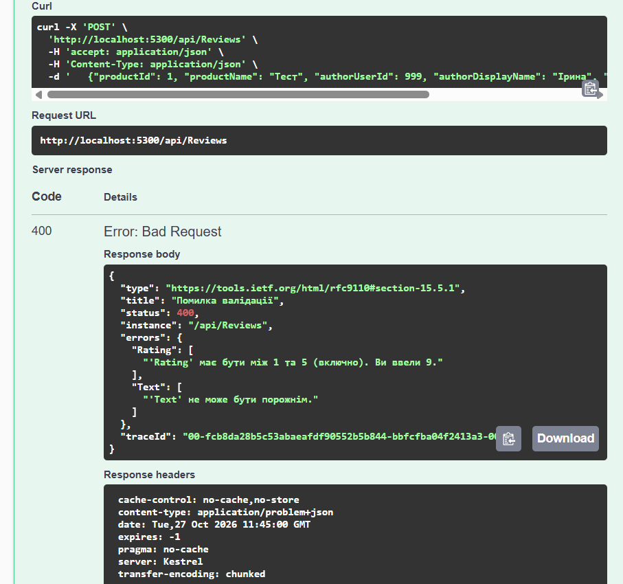


---

# Лаб. 05 — Оркестрація та спостережуваність мікросервісів (.NET Aspire, YARP, OpenTelemetry, Serilog)

**Мета.** Зібрати три мікросервіси з Лаб. 2–4 (Deals, Catalog, Reviews) в одну платформу, яка стартує **однією командою**, має **єдину точку входу** (API Gateway), **агрегований ендпоїнт** (Aggregator) і **наскрізну спостережуваність**: структуровані логи, розподілені трейси та кореляцію запитів.

## Зміст
1. [Архітектура](#1-архітектура)
2. [Як проходить запит](#2-як-проходить-запит)
3. [Запуск](#3-запуск)
4. [Приклади запитів](#4-приклади-запитів)
5. [Спостережуваність: що і як реалізовано](#5-спостережуваність-що-і-як-реалізовано)
6. [Aggregator і часткові відповіді](#6-aggregator-і-часткові-відповіді)
7. [Що змінено в сервісах Лаб. 2–4](#7-що-змінено-в-сервісах-лаб-24)
8. [Структура рішення](#8-структура-рішення)
9. [Перевірка в Dashboard і скріншоти](#9-перевірка-в-dashboard-і-скріншоти)
10. [Відомі обмеження](#10-відомі-обмеження)
11. [Типові проблеми](#11-типові-проблеми)

---

## 1. Архітектура

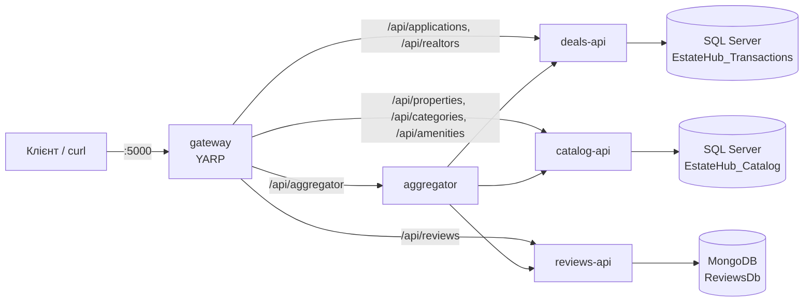

| Компонент | Проєкт | Призначення |
|---|---|---|
| **AppHost** | `Platform.AppHost` | Оркестрація: контейнери SQL Server і MongoDB (`WithDataVolume`), усі сервіси, порядок старту через `WaitFor`, пароль SQL як secret-параметр |
| **ServiceDefaults** | `Platform.ServiceDefaults` | Спільна конфігурація: Serilog, OpenTelemetry, health checks, service discovery, resilience, CorrelationId |
| **API Gateway** | `Platform.ApiGateway` | Єдина точка входу (порт **5000**), маршрути YARP за логічними іменами сервісів |
| **Aggregator** | `Platform.Aggregator` | Aggregator Pattern: збирає картку заявки з трьох сервісів паралельно |
| **Deals / Catalog / Reviews** | `Services/*` | Мікросервіси з Лаб. 2, 3, 4 з мінімальними змінами |

Логічні імена для service discovery: `deals-api`, `catalog-api`, `reviews-api`, `aggregator`, `gateway`.
Назви баз збігаються з іменами рядків підключення, які сервіси використовували і раніше: `DealsDb`, `CatalogDb`, `ReviewsDb`. Тому AppHost просто передає їх через `WithReference`.

## 2. Як проходить запит

1. Клієнт звертається до **gateway** (`http://localhost:5000`).
2. Gateway (middleware `CorrelationIdMiddleware`) бере `X-Correlation-Id` із запиту або генерує новий, кладе його в `LogContext` і в заголовок відповіді.
3. YARP обирає маршрут за шляхом і передає запит на **логічне ім'я** (`http://deals-api`, `http://catalog-api` тощо). Реальну адресу визначає service discovery, у конфігурації жодних портів сервісів немає.
4. При виклику один сервіс → інший (Aggregator → сервіси) `CorrelationIdHandler` (DelegatingHandler) додає той самий `X-Correlation-Id` до вихідного HTTP-запиту.
5. Усі сервіси пишуть логи з одним `CorrelationId`, а OpenTelemetry зв'язує виклики в один trace (`traceparent`).

## 3. Запуск

**Потрібно:** .NET 10 SDK, запущений Docker Desktop.

```bash
# 1. Пароль SQL Server зберігається як секрет AppHost (не в репозиторії).
#    Вимоги SQL Server: ≥ 8 символів, великі й малі літери, цифри.
dotnet user-secrets set "Parameters:sql-password" "<ваш пароль>" --project Platform.AppHost

# 2. Запуск усієї платформи однією командою
dotnet run --project Platform.AppHost
```

Консоль виведе адресу **Aspire Dashboard**. Усі ресурси (`sql`, `mongo`, `deals-api`, `catalog-api`, `reviews-api`, `aggregator`, `gateway`) мають перейти у стан **Running**.

**Порядок старту (`WaitFor`):** бази → сервіси → aggregator → gateway. Сервіс не стартує, доки не готова його база.

**Схема БД Deals (один раз після першого запуску).** Deals працює через Dapper/ADO.NET без міграцій, тому схему, процедури й тестові дані з `db/p1` треба розгорнути в контейнер SQL Server. Скрипт сам знаходить контейнер і виконує `sqlcmd` усередині нього:

```bash
SQL_PASSWORD='<ваш пароль>' bash scripts/deploy-deals-db.sh
```

Після цього перезапустіть `deals-api` у Dashboard. Catalog застосовує EF-міграції та сідінг сам, Reviews сідить MongoDB сам.

> Дані зберігаються у docker volume (`WithDataVolume`), тому повторний запуск не вимагає повторного розгортання схеми.

## 4. Приклади запитів

Усі запити йдуть через Gateway:

```bash
curl -i "http://localhost:5000/api/properties?page=1"          # Catalog
curl -i "http://localhost:5000/api/reviews?productId=4"        # Reviews
curl -i  http://localhost:5000/api/applications                # Deals
```

**Створення заявки.** Кирилицю в `curl` з Git Bash на Windows надійніше передавати як `\u`-послідовності (це валідний JSON):

```bash
curl -i -X POST http://localhost:5000/api/applications \
  -H "Content-Type: application/json" \
  -d '{
    "clientId": "11111111-1111-1111-1111-111111111111",
    "propertyId": "<id об'\''єкта з /api/properties>",
    "priceSnapshot": 54000,
    "propertyTitleSnapshot": "Студія на Подолі"
  }'
```

**Агрегована картка заявки:**

```bash
curl -i "http://localhost:5000/api/aggregator/applications/<id заявки>/full"
```

У кожній відповіді є заголовок `X-Correlation-Id`.

## 5. Спостережуваність: що і як реалізовано

Усе спільне винесено в **`Platform.ServiceDefaults/Extensions.cs`**. Сервіс підключає це одним викликом `builder.AddServiceDefaults()`.

| Напрям | Реалізація |
|---|---|
| **Логи (Serilog)** | Структурований JSON у консоль (`CompactJsonFormatter`); `writeToProviders: true`, тож логи потрапляють і в Aspire Dashboard; рівні: `Debug` у Development, `Information` у Production; перевизначення для шумних категорій (`Microsoft`, `AspNetCore`, `EFCore`, `HttpClient`); збагачувачі `ServiceName`, `EnvironmentName`, `MachineName`, `ThreadId`; властивість `CorrelationId` через `LogContext` |
| **Трейси (OpenTelemetry)** | Інструментація ASP.NET Core, HttpClient, SqlClient, Runtime та MongoDB (`DiagnosticsActivityEventSubscriber`); власні джерела `EstateHub.*`; фільтр, що виключає `/health` і `/alive`; експорт через OTLP до Dashboard |
| **Семплінг** | У Development: `AlwaysOn`; інакше: `ParentBased` з часткою з `OpenTelemetry:SamplingRatio` (за замовчуванням 0.1) |
| **Кореляція** | `CorrelationIdMiddleware` (вхідні запити) + `CorrelationIdHandler` (вихідні HTTP-виклики); заголовок `X-Correlation-Id` |
| **Health checks** | `/health` (готовність) і `/alive` (живість), доступні в Development |
| **Resilience** | Стандартний resilience handler (retry, circuit breaker, timeout) для всіх `HttpClient` |
| **Service discovery** | Логічні імена `http://deals-api` та `https+http://catalog-api` замість адрес і портів |

**CorrelationId і TraceId.** Це різні речі. `TraceId` генерує OpenTelemetry для одного розподіленого трейсу. `CorrelationId` приходить від клієнта (або створюється на gateway) і дозволяє знайти в логах усі записи одного запиту, навіть якщо трейс семплінгом не збережено.

## 6. Aggregator і часткові відповіді

`GET /api/aggregator/applications/{id}/full` збирає **картку заявки**:

1. Спочатку запитує **Deals** (з нього беремо `propertyId` і назву об'єкта; без заявки відповідь `404`).
2. Далі **паралельно** (`Task.WhenAll`) запитує **Catalog** (об'єкт) та **Reviews** (відгуки).
3. Рахує `averageRating` і повертає один композитний DTO.

```json
{
  "application": { "id": "...", "propertyId": "...", "status": "new" },
  "property":    { "title": "Студія на Подолі", "price": 54000, "city": "Київ" },
  "reviews":     [ { "rating": 4, "authorName": "Юрій М." }, { "rating": 5, "authorName": "Наталія Г." } ],
  "averageRating": 4.5,
  "warnings": []
}
```

**Часткові відмови.** Кожен виклик Catalog і Reviews обгорнуто в `SafeAsync`: на запит діє тайм-аут (`ServiceTimeoutSeconds`, за замовчуванням 3 с), а при помилці чи тайм-ауті відповідь **лишається `200`**. Недоступна частина порожня, а в `warnings` з'являється пояснення, наприклад `"reviews-api is unavailable"`. Скасування запиту клієнтом (`CancellationToken`) на такі попередження не перетворюється.

> Тайм-аут нашого агрегатора навмисно коротший за повні retry стандартного resilience handler, інакше недоступність сервісу виявлялася б надто довго.

**Демо:** зупиніть `reviews-api` у Dashboard і повторіть запит. Відповідь `200`, дані заявки та об'єкта є, `reviews` порожні, у `warnings` повідомлення (приблизно через 3 с). Запустіть сервіс знову, і відповідь знову повна.

## 7. Що змінено в сервісах Лаб. 2–4

Бізнес-логіка не змінювалася. Зміни мінімальні:

| Сервіс | Зміни |
|---|---|
| Усі три | `builder.AddServiceDefaults()`, `app.UseMiddleware<CorrelationIdMiddleware>()`, `app.MapDefaultEndpoints()` у `Program.cs`; посилання на `Platform.ServiceDefaults` |
| Catalog | Прибрано власні налаштування Serilog і власний `CorrelationIdMiddleware` (замінені ServiceDefaults) |
| Reviews | Рядок підключення `ConnectionStrings:ReviewsDb` від Aspire має пріоритет над `MongoDb:ConnectionString`; драйвер MongoDB підписано на трасування |
| Deals, Catalog, Reviews | Структуровані логи бізнес-подій (`ApplicationId`, `PropertyId`, `Status` тощо) і власні spans (`ActivitySource` `EstateHub.*`) |

## 8. Структура рішення

```text
Platform.slnx
Platform.AppHost/            # оркестрація (AppHost.cs)
Platform.ServiceDefaults/    # Extensions.cs, CorrelationId.cs
Platform.ApiGateway/         # YARP, appsettings.json з маршрутами
Platform.Aggregator/         # Clients, Models, Services, Controllers
Services/
  Deals/    (Deals.Api, Deals.Bll, Deals.Dal, Deals.Domain)
  Catalog/  (Catalog.Api, Catalog.Bll, Catalog.Dal, Catalog.Domain)
  Reviews/  (Reviews.Domain, .Application, .Infrastructure, .WebApi)
scripts/deploy-deals-db.sh   # розгортання схеми Deals у контейнер
db/p1/                       # schema.sql, procedures.sql, seed.sql (Deals)
docs/lab05/                  # скріншоти
```

## 9. Перевірка в Dashboard і скріншоти

1. **Resources:** усі ресурси у стані Running.
2. **Traces:** trace запиту до `/api/aggregator/...` показує ієрархію `gateway → aggregator → deals-api / catalog-api / reviews-api → SQL / MongoDB`; виклики catalog і reviews перекриваються в часі, тобто виконуються паралельно.
3. **Structured logs:** фільтр за `CorrelationId` (значення з заголовка відповіді) показує записи всіх сервісів ланцюжка з полями `ServiceName`, `EnvironmentName`, `MachineName`, `TraceId`, `SpanId`.
4. **Часткова відповідь:** відповідь з `warnings` при зупиненому `reviews-api`.

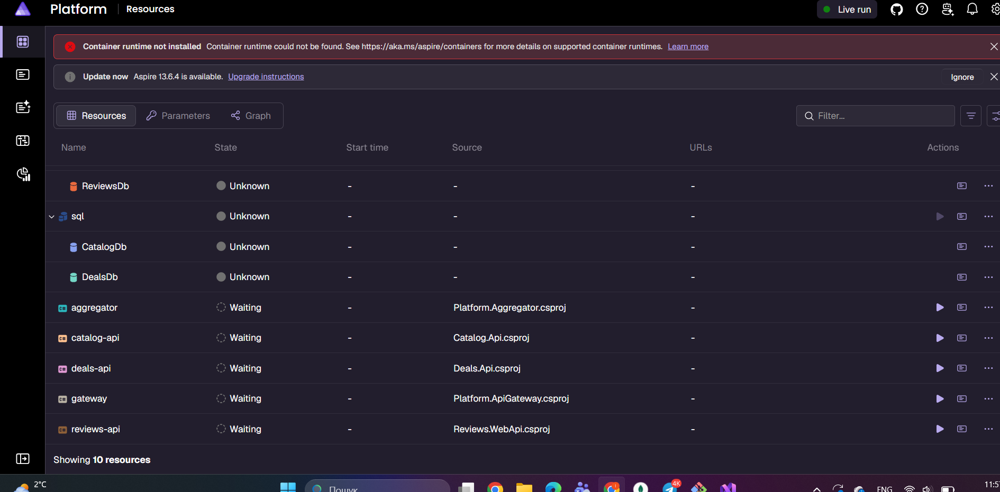

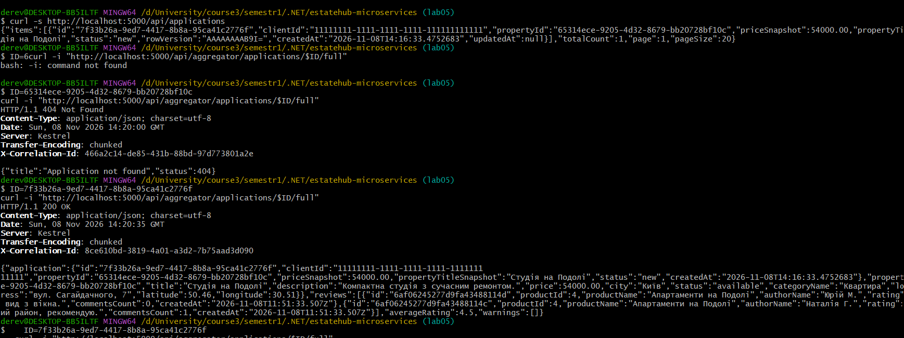

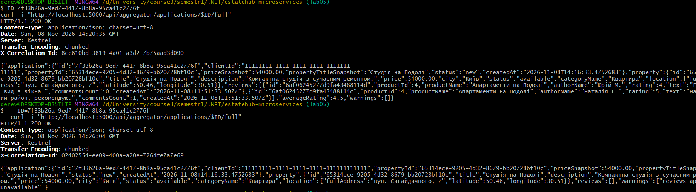

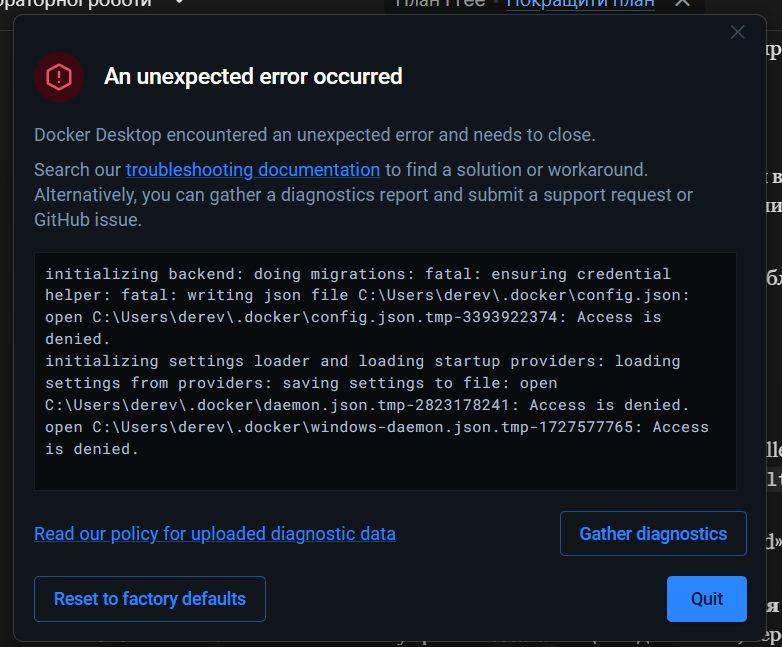

## 10. Відомі обмеження

- **Зв'язок Reviews ↔ Catalog.** У Reviews (Лаб. 4) об'єкт ідентифікується числом `productId`, а в Catalog/Deals це `Guid`. Тому Aggregator зіставляє назву об'єкта з `productId` через `Aggregator:ReviewProductMap` у `Platform.Aggregator/appsettings.json`. Це тимчасове рішення, а в майбутньому `productId` варто замінити на `Guid` об'єкта.
- **Seed-заявка Deals** посилається на неіснуючий `PropertyId`, тому для повної картки створіть заявку з реальним `propertyId` і `propertyTitleSnapshot`, що збігається з назвою об'єкта з Catalog.
- Схему Deals треба розгорнути вручну один раз (див. розділ 3), бо Deals не використовує міграції.

## 11. Типові проблеми

| Симптом | Причина і рішення |
|---|---|
| `docker: command not found` у Git Bash | `export PATH="$PATH:/c/Program Files/Docker/Docker/resources/bin"` |
| Dashboard: «Container runtime not installed / unhealthy» | Запустіть Docker Desktop і дочекайтеся стану Running |
| `sqlcmd` з хоста: «TCP Provider: wait operation timed out» | Порт контейнера призначає Aspire. Використовуйте `scripts/deploy-deals-db.sh` (виконується всередині контейнера) |
| `/api/applications` повертає 500 | Не розгорнуто схему Deals. Запустіть скрипт і перезапустіть `deals-api` |
| `400` на POST із кирилицею у Git Bash | Передавайте кирилицю як `\uXXXX` (розділ 4) |
| `dotnet build` падає з `MSB3027` (файл зайнятий) | AppHost ще працює. Зупиніть його (Ctrl+C) перед збіркою |


---

# Лаб. 06 — gRPC та кешування в мікросервісній платформі (Redis, IMemoryCache, Protocol Buffers)

**Мета.** Розширити платформу з Лаб. 05: прискорити читання даних **двохрівневим кешем** (пам'ять → Redis → БД), перевести внутрішні виклики Aggregator з HTTP на **gRPC** та побачити все це в Aspire Dashboard (трейси, логи, метрики).

## Зміст
1. [Що додано і де це лежить](#1-що-додано-і-де-це-лежить)
2. [Кешування](#2-кешування)
3. [gRPC](#3-grpc)
4. [Aggregator на gRPC](#4-aggregator-на-grpc)
5. [Спостережуваність](#5-спостережуваність)
6. [Запуск](#6-запуск)
7. [Самоперевірка](#7-самоперевірка)
8. [Порівняння HTTP і gRPC](#8-порівняння-http-і-grpc)
9. [Скріншоти](#9-скріншоти)
10. [Обмеження та рішення](#10-обмеження-та-рішення)

---

## 1. Що додано і де це лежить

| Вимога | Реалізація |
|---|---|
| Redis в AppHost з постійним сховищем | `Platform.AppHost/AppHost.cs`: `AddRedis("redis").WithDataVolume()`, `WithReference(redis).WaitFor(redis)` для сервісів і Aggregator |
| `.proto`-контракти (Server / Client) | `Services/Catalog/Catalog.Api/Protos/catalog.proto`, `Services/Deals/Deals.Api/Protos/deals.proto`, `Services/Reviews/Reviews.WebApi/Protos/reviews.proto`; у `.csproj` сервісів `GrpcServices="Server"`, у `Platform.Aggregator.csproj` ті самі файли з `GrpcServices="Client"` |
| `IMemoryCache` з обмеженням розміру | `AddMemoryCache(o => o.SizeLimit = 10_000)` у `Program.cs` кожного сервісу; кожен запис має `Size = 1`, `Priority` і абсолютний термін життя |
| Cache-aside, передбачувані ключі | `*/Caching/*CacheKeys.cs`, декоратори `CachedPropertyService`, `CachedCategoryService`, `CachedApplicationService`, `CachedRealtorService`, `QueryCachingBehavior` (Reviews) |
| Інвалідація при записі | ті самі декоратори/behaviors: `RemoveAsync` / `BumpVersionAsync` одразу після успішної операції запису |
| `IDistributedCache` через Aspire | `builder.AddRedisDistributedCache("redis")` у сервісах і Aggregator |
| Дворівневий кеш L1 → L2 → БД | `Caching/TwoLevelCache.cs` (у `Catalog.Bll`, `Deals.Bll`, `Reviews.Application`, `Platform.Aggregator`) |
| gRPC-сервіси як адаптери над BLL з `RpcException` | `Catalog.Api/Grpc/CatalogGrpcService.cs`, `Deals.Api/Grpc/DealsGrpcService.cs`, `Reviews.WebApi/Grpc/ReviewsGrpcService.cs` |
| Типізовані gRPC-клієнти з service discovery | `Platform.Aggregator/Program.cs`: `AddGrpcClient<...>(o => o.Address = new Uri("https://deals-api"))` |
| Паралельні виклики, часткові відмови | `Platform.Aggregator/Services/GrpcApplicationAggregationService.cs` (`Task.WhenAll`, `RpcException` → `warnings`) |
| Кеш агрегованої відповіді з коротким TTL | `Platform.Aggregator/Services/CachedApplicationAggregator.cs` (L1 10 с, Redis 30 с) |
| Серверний interceptor логування | `Platform.ServiceDefaults/GrpcLogging.cs` (`GrpcLoggingInterceptor`), підключення `services.AddServiceGrpc()`; клієнтський: `Platform.Aggregator/Grpc/GrpcClientLoggingInterceptor.cs` |
| Метрики кешу через `Meter` | `Caching/CacheMetrics.cs` (`cache.hits`, `cache.misses`, `cache.invalidations`, `cache.evictions`, `cache.errors`, `cache.duration`); meters додано в `Platform.ServiceDefaults/Extensions.cs` |
| CorrelationId у метаданих gRPC | `CorrelationIdHandler` з Лаб. 05 додає `X-Correlation-Id` до всіх запитів `HttpClient`, у т. ч. gRPC; сервер читає його в `CorrelationIdMiddleware` |

## 2. Кешування

### Читання: L1 → L2 → база даних

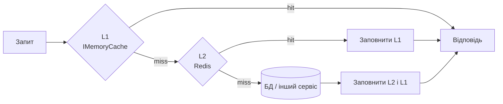

Кожен рівень заповнюється «на зворотному шляху». **L1 завжди живе коротше за L2**: інакше застарілі дані в пам'яті переживуть оновлення в Redis.

### Що кешується і на скільки

| Сервіс | Ключ | L1 | L2 (Redis) | Інвалідація |
|---|---|---|---|---|
| Catalog | `catalog:property:{id}` | 1 хв | 5 хв | PUT/DELETE/зміна ціни, статусу, зручностей |
| Catalog | `catalog:properties:list:v{версія}:...` (списки з фільтрами) | 30 с | 2 хв | зміна версії групи при будь-якому записі |
| Catalog | `catalog:properties:featured:v{версія}:{місто}:{ліміт}` | 30 с | 2 хв | те саме |
| Catalog | `catalog:categories:all`, `catalog:category:{id}` (довідник) | 5 хв | 30 хв | створення категорії |
| Deals | `deals:application:{id}` | 15 с | 60 с | будь-яка зміна статусу, затвердження, договір, видалення |
| Deals | `deals:realtor:{id}`, `deals:realtors:all` (довідник) | 2 хв | 10 хв | створення/оновлення/деактивація |
| Reviews | `reviews:review:{id}` | 1 хв | 5 хв | оновлення, коментар, видалення |
| Reviews | `reviews:list:v{версія}:...` | 30 с | 2 хв | будь-який запис (зміна версії) |
| Aggregator | `aggregator:application:{id}:full` | 10 с | 30 с | TTL + `DELETE /api/aggregator/applications/{id}/cache` |

Принципи вибору:
- кешуємо **часто читане й рідко змінюване** (картка об'єкта, довідники), а не все підряд;
- персональний контекст (заявка з `ClientId`) кешується **недовго**;
- агрегат живе **коротше** за кеші окремих сервісів, щоб виглядати не «свіжішим», ніж дані, з яких його зібрано;
- ключі мають префікс сервісу (`catalog:`, `deals:`, `reviews:`, `aggregator:`), тож у спільному Redis вони не змішуються.

### Масова інвалідація списків: ключ-версія
Список залежить від багатьох параметрів (фільтри, сторінка), тому видаляти його ключі по одному неможливо. У ключ списку входить **версія групи** (`catalog:properties:ver`). Будь-який запис змінює версію, і всі попередні списки одним кроком перестають використовуватися, а потім самі зникають за TTL. Версія зберігається в Redis, тож її бачать усі екземпляри (з L1-затримкою до 5 с).

### Інвалідація синхронна із записом
Спершу виконується операція в БД, і лише після її успіху кеш видаляється з **обох** рівнів. Якщо операція впала, кеш не чіпається. Причина кожної інвалідації логується (`Cache invalidated {Key}, reason {Reason}`) і рахується в метриці.

### Redis недоступний, сервіс працює далі
Усі операції з L2 обгорнуто так, що **будь-який збій Redis означає «L2 недоступний»**:
- кожна операція має тайм-аут 500 мс (Redis не гальмує запит);
- після збою L2 пропускається на 15 с («автомат»), запити йдуть у БД, у лог пишеться попередження, росте метрика `cache.errors`;
- скасування запиту клієнтом (`CancellationToken`) при цьому **не ковтається**.

### Захист пам'яті
`SizeLimit = 10 000` у `IMemoryCache`. Кожен запис має `Size = 1`, `Priority` (довідники мають `High`, тож витісняються в останню чергу) та абсолютний термін життя. Витіснення рахуються метрикою `cache.evictions`.

### Чому не HybridCache
У .NET є готовий `HybridCache` (L1 + L2 і захист від одночасного перерахунку одного значення). У роботі схему реалізовано **вручну**, щоб було видно механізм: порядок рівнів, заповнення «назад», різні TTL, відмовостійкість Redis. Перехід на `HybridCache` потребував би змінити лише клас `TwoLevelCache`.

## 3. gRPC

| Сервіс | Контракт | Методи | Джерело даних |
|---|---|---|---|
| Catalog | `catalog.proto` | `GetProperty`, `GetPropertiesByIds`, `ListCategories` | ті самі кешовані `IPropertyService`/`ICategoryService`, що й REST |
| Deals | `deals.proto` | `GetApplication` | кешований `IApplicationService` |
| Reviews | `reviews.proto` | `GetReview`, `GetReviewsByProduct` | запити MediatR через `ISender` (ті самі behaviors і кеш) |

- gRPC-сервіс — **адаптер** над BLL, як контролер: валідує вхід, викликає сервіс, перетворює модель у повідомлення. Через ті самі сервіси **кеш працює для REST і gRPC без дублювання коду**.
- Помилки — це `RpcException` з правильним статусом: не знайдено → `NotFound`, некоректний id → `InvalidArgument` (а не `Unknown`/`Internal`).
- Запис лишається в REST: gRPC використовується для читання між сервісами.
- **Номери полів у `.proto` не змінюються після публікації**: саме вони, а не імена, визначають бінарний формат.
- `Guid` передається рядком, дата — `google.protobuf.Timestamp`, необов'язкові координати — `optional double`.

### HTTP/2
gRPC працює поверх HTTP/2. Kestrel на HTTPS-endpoint узгоджує HTTP/2 автоматично (ALPN), тому REST (HTTP/1.1) і gRPC живуть в **одному порту**. Для цього Catalog і Reviews отримали профіль `https` у `launchSettings.json` (Deals його вже мав). Gateway звертається до сервісів за `http://...` (REST), Aggregator за `https://...` (gRPC). Для зовнішніх клієнтів платформа, як і раніше, відкрита лише через HTTP на Gateway.

## 4. Aggregator на gRPC

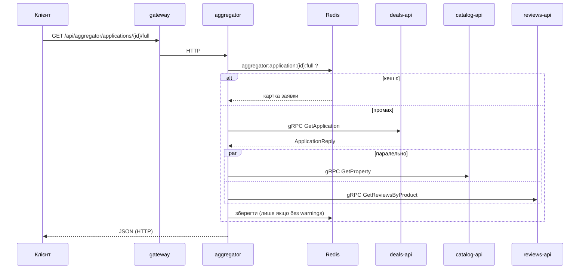

- Клієнти реєструються через `AddGrpcClient<T>` з адресою за **логічним іменем** (`https://deals-api`), тож service discovery, resilience і `CorrelationIdHandler` з ServiceDefaults діють так само, як для `HttpClient` у Лаб. 05.
- Кожен виклик має **дедлайн** (`ServiceTimeoutSeconds`, 3 с) і приймає `CancellationToken`.
- Заявка обов'язкова: `NotFound` → `404`, недоступність Deals → `503`. Збій Catalog чи Reviews (`Unavailable`, `DeadlineExceeded`, інші статуси) **не ламає відповідь**: вона `200` з порожньою частиною та рядком у `warnings`.
- **Часткові відповіді не кешуються**, інакше тимчасовий збій «застряг» би в кеші.
- Параметри запиту: `?transport=http|grpc` (за замовчуванням `grpc`) та `?nocache=true`. HTTP-версію з Лаб. 05 збережено саме для порівняння швидкості.
- У відповіді є заголовки `X-Aggregator-Transport` та `X-Aggregator-Elapsed-Ms`.

## 5. Спостережуваність

| Що | Де дивитися в Dashboard |
|---|---|
| gRPC-spans клієнта й сервера в одному trace (`rpc.service`, `rpc.method`, зв'язок батько–нащадок) | **Traces** → запит до `/api/aggregator/...?nocache=true` |
| Операції кешу: span `cache.get_or_create` з тегами `cache.key` і `cache.result` (`l1_hit` / `l2_hit` / `miss`), команди Redis | **Traces** |
| Повторне читання без SQL-span | **Traces** → другий запит того самого об'єкта |
| Логи gRPC: метод, адреса клієнта, статус, тривалість | **Structured logs**, фільтр `gRPC` |
| Логи кешу: `Cache hit L1/L2`, `Cache miss`, `Cache invalidated`, `Redis (L2) unavailable` | **Structured logs**, фільтр `Cache` |
| `CorrelationId` у метаданих gRPC | **Structured logs**, фільтр за значенням із заголовка відповіді: записи Gateway, Aggregator і сервісів |
| `cache.hits`, `cache.misses` (тег `cache.level`), `cache.invalidations`, `cache.evictions`, `cache.errors`, `cache.duration` | **Metrics** → `Catalog.Cache`, `Deals.Cache`, `Reviews.Cache`, `Aggregator.Cache` |
| Вбудовані метрики gRPC | **Metrics** → `Grpc.AspNetCore.Server`, `Grpc.Net.Client` |

Hit ratio = `cache.hits / (cache.hits + cache.misses)` для потрібного `cache.level`.

## 6. Запуск

```bash
# один раз: довірений dev-сертифікат (потрібен gRPC поверх HTTPS)
dotnet dev-certs https --trust

dotnet run --project Platform.AppHost
```

У Dashboard має з'явитися ресурс **redis** (Running), а всі сервіси стартують після нього. Решта кроків (пароль SQL, схема Deals) без змін, див. Лаб. 05.

## 7. Самоперевірка

Нехай `PID` — id об'єкта з `GET http://localhost:5000/api/properties`.

1. **Повторне читання без SQL.** Двічі виконайте `curl http://localhost:5000/api/properties/$PID`. У Traces **другий** запит не містить SQL-span, а в логах `Cache hit L1`.
2. **Зміна даних інвалідує кеш.**
   ```bash
   curl -X PUT http://localhost:5000/api/properties/$PID/price \
     -H "Content-Type: application/json" -d '{"price": 99999}'
   curl http://localhost:5000/api/properties/$PID     # ціна 99999, а не стара
   ```
   У логах `Cache invalidated catalog:property:{id}, reason PriceChanged`.
3. **Redis зупинено, сервіс працює.** Зупиніть `redis` у Dashboard і виконайте запит: він повільніший, але успішний, у логах `Redis (L2) unavailable`, зростає `cache.errors`. Запустіть Redis знову.
4. **gRPC статуси.** Aggregator для неіснуючої заявки повертає `404` (внутрішньо `NotFound`), а не `500`.
5. **Часткова відповідь.** Зупиніть `catalog-api` і виконайте `GET .../full?nocache=true`: `200` з рядком у `warnings`.
6. **Порівняння тривалості:** розділ 8.
7. **Номер поля в `.proto`.** У `catalog.proto` на **сервері** змініть номер поля (наприклад, `price = 4` на `price = 14`) і перезапустіть лише `catalog-api`. Клієнт перестане коректно читати це поле (ціна в агрегаті буде `0`). Поверніть номер назад. Це демонструє, чому номери полів незмінні.

## 8. Порівняння HTTP і gRPC

```bash
bash scripts/benchmark-aggregator.sh <id заявки> 30
```

Скрипт робить 3 прогрівальні та 30 вимірювальних запитів на варіант через Gateway (різниця лише в транспорті між Aggregator і сервісами). Результати (середнє, мін, медіана, p95), мс:


Додатково в Traces порівняйте тривалість span `AggregateApplication.Http` і `AggregateApplication.Grpc`. Сервісні кеші діють в обох варіантах однаково, тож порівняння чесне.

## 10. Обмеження та рішення

- **L1 у кожного екземпляра свій.** Після запису інший екземпляр може віддавати старі дані до закінчення L1-TTL (≤ 1 хв для карток, ≤ 15 с для заявок). Для миттєвої синхронізації L1 між репліками потрібен Redis pub/sub (за бажанням у завданні).
- **Агрегат інвалідується за TTL та вручну** (`DELETE /api/aggregator/applications/{id}/cache`), а не подіями від сервісів: у платформі немає шини повідомлень.
- **Зв'язок Reviews ↔ Catalog** (число `productId` проти `Guid`) вирішується відображенням у `Aggregator:ReviewProductMap`, як і в Лаб. 05.
- **gRPC лише для читання**; запис через REST.
- **У Development Aggregator довіряє dev-сертифікату** локальних сервісів (щоб gRPC не залежав від налаштувань системи). У production цього немає.
- Гроші в `.proto` передано як `double` для простоти; у production краще окреме повідомлення `units`/`nanos`.
- Кожен сервіс має **власну копію** `TwoLevelCache` (у своєму шарі `Caching/`): мікросервіси не діляться бібліотеками, а їхні кеші незалежні.
