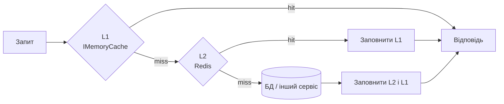
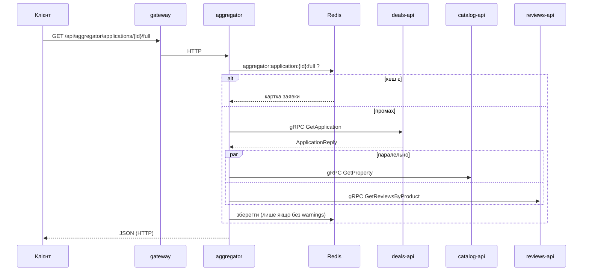

---

# Лаб. 06 — gRPC та кешування в мікросервісній платформі (Redis, IMemoryCache, Protocol Buffers)

**Мета.** Розширити платформу з Лаб. 05: прискорити читання даних **двохрівневим кешем** (пам'ять → Redis → БД), перевести внутрішні виклики Aggregator з HTTP на **gRPC** та побачити все це в Aspire Dashboard (трейси, логи, метрики).

## Зміст
1. [Що додано і де це лежить](#1-що-додано-і-де-це-лежить)
2. [Кешування](#2-кешування)
3. [gRPC](#3-grpc)
4. [Aggregator на gRPC](#4-aggregator-на-grpc)
5. [Спостережуваність](#5-спостережуваність)
6. [Запуск](#6-запуск)
7. [Самоперевірка](#7-самоперевірка)
8. [Порівняння HTTP і gRPC](#8-порівняння-http-і-grpc)
9. [Скріншоти](#9-скріншоти)
10. [Обмеження та рішення](#10-обмеження-та-рішення)

---

## 1. Що додано і де це лежить

| Вимога | Реалізація |
|---|---|
| Redis в AppHost з постійним сховищем | `Platform.AppHost/AppHost.cs`: `AddRedis("redis").WithDataVolume()`, `WithReference(redis).WaitFor(redis)` для сервісів і Aggregator |
| `.proto`-контракти (Server / Client) | `Services/Catalog/Catalog.Api/Protos/catalog.proto`, `Services/Deals/Deals.Api/Protos/deals.proto`, `Services/Reviews/Reviews.WebApi/Protos/reviews.proto`; у `.csproj` сервісів `GrpcServices="Server"`, у `Platform.Aggregator.csproj` ті самі файли з `GrpcServices="Client"` |
| `IMemoryCache` з обмеженням розміру | `AddMemoryCache(o => o.SizeLimit = 10_000)` у `Program.cs` кожного сервісу; кожен запис має `Size = 1`, `Priority` і абсолютний термін життя |
| Cache-aside, передбачувані ключі | `*/Caching/*CacheKeys.cs`, декоратори `CachedPropertyService`, `CachedCategoryService`, `CachedApplicationService`, `CachedRealtorService`, `QueryCachingBehavior` (Reviews) |
| Інвалідація при записі | ті самі декоратори/behaviors: `RemoveAsync` / `BumpVersionAsync` одразу після успішної операції запису |
| `IDistributedCache` через Aspire | `builder.AddRedisDistributedCache("redis")` у сервісах і Aggregator |
| Дворівневий кеш L1 → L2 → БД | `Caching/TwoLevelCache.cs` (у `Catalog.Bll`, `Deals.Bll`, `Reviews.Application`, `Platform.Aggregator`) |
| gRPC-сервіси як адаптери над BLL з `RpcException` | `Catalog.Api/Grpc/CatalogGrpcService.cs`, `Deals.Api/Grpc/DealsGrpcService.cs`, `Reviews.WebApi/Grpc/ReviewsGrpcService.cs` |
| Типізовані gRPC-клієнти з service discovery | `Platform.Aggregator/Program.cs`: `AddGrpcClient<...>(o => o.Address = new Uri("https://deals-api"))` |
| Паралельні виклики, часткові відмови | `Platform.Aggregator/Services/GrpcApplicationAggregationService.cs` (`Task.WhenAll`, `RpcException` → `warnings`) |
| Кеш агрегованої відповіді з коротким TTL | `Platform.Aggregator/Services/CachedApplicationAggregator.cs` (L1 10 с, Redis 30 с) |
| Серверний interceptor логування | `Platform.ServiceDefaults/GrpcLogging.cs` (`GrpcLoggingInterceptor`), підключення `services.AddServiceGrpc()`; клієнтський: `Platform.Aggregator/Grpc/GrpcClientLoggingInterceptor.cs` |
| Метрики кешу через `Meter` | `Caching/CacheMetrics.cs` (`cache.hits`, `cache.misses`, `cache.invalidations`, `cache.evictions`, `cache.errors`, `cache.duration`); meters додано в `Platform.ServiceDefaults/Extensions.cs` |
| CorrelationId у метаданих gRPC | `CorrelationIdHandler` з Лаб. 05 додає `X-Correlation-Id` до всіх запитів `HttpClient`, у т. ч. gRPC; сервер читає його в `CorrelationIdMiddleware` |

## 2. Кешування

### Читання: L1 → L2 → база даних



Кожен рівень заповнюється «на зворотному шляху». **L1 завжди живе коротше за L2**: інакше застарілі дані в пам'яті переживуть оновлення в Redis.

### Що кешується і на скільки

| Сервіс | Ключ | L1 | L2 (Redis) | Інвалідація |
|---|---|---|---|---|
| Catalog | `catalog:property:{id}` | 1 хв | 5 хв | PUT/DELETE/зміна ціни, статусу, зручностей |
| Catalog | `catalog:properties:list:v{версія}:...` (списки з фільтрами) | 30 с | 2 хв | зміна версії групи при будь-якому записі |
| Catalog | `catalog:properties:featured:v{версія}:{місто}:{ліміт}` | 30 с | 2 хв | те саме |
| Catalog | `catalog:categories:all`, `catalog:category:{id}` (довідник) | 5 хв | 30 хв | створення категорії |
| Deals | `deals:application:{id}` | 15 с | 60 с | будь-яка зміна статусу, затвердження, договір, видалення |
| Deals | `deals:realtor:{id}`, `deals:realtors:all` (довідник) | 2 хв | 10 хв | створення/оновлення/деактивація |
| Reviews | `reviews:review:{id}` | 1 хв | 5 хв | оновлення, коментар, видалення |
| Reviews | `reviews:list:v{версія}:...` | 30 с | 2 хв | будь-який запис (зміна версії) |
| Aggregator | `aggregator:application:{id}:full` | 10 с | 30 с | TTL + `DELETE /api/aggregator/applications/{id}/cache` |

Принципи вибору:
- кешуємо **часто читане й рідко змінюване** (картка об'єкта, довідники), а не все підряд;
- персональний контекст (заявка з `ClientId`) кешується **недовго**;
- агрегат живе **коротше** за кеші окремих сервісів, щоб виглядати не «свіжішим», ніж дані, з яких його зібрано;
- ключі мають префікс сервісу (`catalog:`, `deals:`, `reviews:`, `aggregator:`), тож у спільному Redis вони не змішуються.

### Масова інвалідація списків: ключ-версія
Список залежить від багатьох параметрів (фільтри, сторінка), тому видаляти його ключі по одному неможливо. У ключ списку входить **версія групи** (`catalog:properties:ver`). Будь-який запис змінює версію, і всі попередні списки одним кроком перестають використовуватися, а потім самі зникають за TTL. Версія зберігається в Redis, тож її бачать усі екземпляри (з L1-затримкою до 5 с).

### Інвалідація синхронна із записом
Спершу виконується операція в БД, і лише після її успіху кеш видаляється з **обох** рівнів. Якщо операція впала, кеш не чіпається. Причина кожної інвалідації логується (`Cache invalidated {Key}, reason {Reason}`) і рахується в метриці.

### Redis недоступний, сервіс працює далі
Усі операції з L2 обгорнуто так, що **будь-який збій Redis означає «L2 недоступний»**:
- кожна операція має тайм-аут 500 мс (Redis не гальмує запит);
- після збою L2 пропускається на 15 с («автомат»), запити йдуть у БД, у лог пишеться попередження, росте метрика `cache.errors`;
- скасування запиту клієнтом (`CancellationToken`) при цьому **не ковтається**.

### Захист пам'яті
`SizeLimit = 10 000` у `IMemoryCache`. Кожен запис має `Size = 1`, `Priority` (довідники мають `High`, тож витісняються в останню чергу) та абсолютний термін життя. Витіснення рахуються метрикою `cache.evictions`.

### Чому не HybridCache
У .NET є готовий `HybridCache` (L1 + L2 і захист від одночасного перерахунку одного значення). У роботі схему реалізовано **вручну**, щоб було видно механізм: порядок рівнів, заповнення «назад», різні TTL, відмовостійкість Redis. Перехід на `HybridCache` потребував би змінити лише клас `TwoLevelCache`.

## 3. gRPC

| Сервіс | Контракт | Методи | Джерело даних |
|---|---|---|---|
| Catalog | `catalog.proto` | `GetProperty`, `GetPropertiesByIds`, `ListCategories` | ті самі кешовані `IPropertyService`/`ICategoryService`, що й REST |
| Deals | `deals.proto` | `GetApplication` | кешований `IApplicationService` |
| Reviews | `reviews.proto` | `GetReview`, `GetReviewsByProduct` | запити MediatR через `ISender` (ті самі behaviors і кеш) |

- gRPC-сервіс — **адаптер** над BLL, як контролер: валідує вхід, викликає сервіс, перетворює модель у повідомлення. Через ті самі сервіси **кеш працює для REST і gRPC без дублювання коду**.
- Помилки — це `RpcException` з правильним статусом: не знайдено → `NotFound`, некоректний id → `InvalidArgument` (а не `Unknown`/`Internal`).
- Запис лишається в REST: gRPC використовується для читання між сервісами.
- **Номери полів у `.proto` не змінюються після публікації**: саме вони, а не імена, визначають бінарний формат.
- `Guid` передається рядком, дата — `google.protobuf.Timestamp`, необов'язкові координати — `optional double`.

### HTTP/2
gRPC працює поверх HTTP/2. Kestrel на HTTPS-endpoint узгоджує HTTP/2 автоматично (ALPN), тому REST (HTTP/1.1) і gRPC живуть в **одному порту**. Для цього Catalog і Reviews отримали профіль `https` у `launchSettings.json` (Deals його вже мав). Gateway звертається до сервісів за `http://...` (REST), Aggregator за `https://...` (gRPC). Для зовнішніх клієнтів платформа, як і раніше, відкрита лише через HTTP на Gateway.

## 4. Aggregator на gRPC



- Клієнти реєструються через `AddGrpcClient<T>` з адресою за **логічним іменем** (`https://deals-api`), тож service discovery, resilience і `CorrelationIdHandler` з ServiceDefaults діють так само, як для `HttpClient` у Лаб. 05.
- Кожен виклик має **дедлайн** (`ServiceTimeoutSeconds`, 3 с) і приймає `CancellationToken`.
- Заявка обов'язкова: `NotFound` → `404`, недоступність Deals → `503`. Збій Catalog чи Reviews (`Unavailable`, `DeadlineExceeded`, інші статуси) **не ламає відповідь**: вона `200` з порожньою частиною та рядком у `warnings`.
- **Часткові відповіді не кешуються**, інакше тимчасовий збій «застряг» би в кеші.
- Параметри запиту: `?transport=http|grpc` (за замовчуванням `grpc`) та `?nocache=true`. HTTP-версію з Лаб. 05 збережено саме для порівняння швидкості.
- У відповіді є заголовки `X-Aggregator-Transport` та `X-Aggregator-Elapsed-Ms`.

## 5. Спостережуваність

| Що | Де дивитися в Dashboard |
|---|---|
| gRPC-spans клієнта й сервера в одному trace (`rpc.service`, `rpc.method`, зв'язок батько–нащадок) | **Traces** → запит до `/api/aggregator/...?nocache=true` |
| Операції кешу: span `cache.get_or_create` з тегами `cache.key` і `cache.result` (`l1_hit` / `l2_hit` / `miss`), команди Redis | **Traces** |
| Повторне читання без SQL-span | **Traces** → другий запит того самого об'єкта |
| Логи gRPC: метод, адреса клієнта, статус, тривалість | **Structured logs**, фільтр `gRPC` |
| Логи кешу: `Cache hit L1/L2`, `Cache miss`, `Cache invalidated`, `Redis (L2) unavailable` | **Structured logs**, фільтр `Cache` |
| `CorrelationId` у метаданих gRPC | **Structured logs**, фільтр за значенням із заголовка відповіді: записи Gateway, Aggregator і сервісів |
| `cache.hits`, `cache.misses` (тег `cache.level`), `cache.invalidations`, `cache.evictions`, `cache.errors`, `cache.duration` | **Metrics** → `Catalog.Cache`, `Deals.Cache`, `Reviews.Cache`, `Aggregator.Cache` |
| Вбудовані метрики gRPC | **Metrics** → `Grpc.AspNetCore.Server`, `Grpc.Net.Client` |

Hit ratio = `cache.hits / (cache.hits + cache.misses)` для потрібного `cache.level`.

## 6. Запуск

```bash
# один раз: довірений dev-сертифікат (потрібен gRPC поверх HTTPS)
dotnet dev-certs https --trust

dotnet run --project Platform.AppHost
```

У Dashboard має з'явитися ресурс **redis** (Running), а всі сервіси стартують після нього. Решта кроків (пароль SQL, схема Deals) без змін, див. Лаб. 05.

## 7. Самоперевірка

Нехай `PID` — id об'єкта з `GET http://localhost:5000/api/properties`.

1. **Повторне читання без SQL.** Двічі виконайте `curl http://localhost:5000/api/properties/$PID`. У Traces **другий** запит не містить SQL-span, а в логах `Cache hit L1`.
2. **Зміна даних інвалідує кеш.**
   ```bash
   curl -X PUT http://localhost:5000/api/properties/$PID/price \
     -H "Content-Type: application/json" -d '{"price": 99999}'
   curl http://localhost:5000/api/properties/$PID     # ціна 99999, а не стара
   ```
   У логах `Cache invalidated catalog:property:{id}, reason PriceChanged`.
3. **Redis зупинено, сервіс працює.** Зупиніть `redis` у Dashboard і виконайте запит: він повільніший, але успішний, у логах `Redis (L2) unavailable`, зростає `cache.errors`. Запустіть Redis знову.
4. **gRPC статуси.** Aggregator для неіснуючої заявки повертає `404` (внутрішньо `NotFound`), а не `500`.
5. **Часткова відповідь.** Зупиніть `catalog-api` і виконайте `GET .../full?nocache=true`: `200` з рядком у `warnings`.
6. **Порівняння тривалості:** розділ 8.
7. **Номер поля в `.proto`.** У `catalog.proto` на **сервері** змініть номер поля (наприклад, `price = 4` на `price = 14`) і перезапустіть лише `catalog-api`. Клієнт перестане коректно читати це поле (ціна в агрегаті буде `0`). Поверніть номер назад. Це демонструє, чому номери полів незмінні.

## 8. Порівняння HTTP і gRPC

```bash
bash scripts/benchmark-aggregator.sh <id заявки> 30
```

Скрипт робить 3 прогрівальні та 30 вимірювальних запитів на варіант через Gateway (різниця лише в транспорті між Aggregator і сервісами). Результати (середнє, мін, медіана, p95), мс:

| Варіант | Середнє | Медіана | p95 |
|---|---|---|---|
| HTTP (Лаб. 05) | _заповнити_ | _заповнити_ | _заповнити_ |
| gRPC (Лаб. 06) | _заповнити_ | _заповнити_ | _заповнити_ |
| gRPC + кеш агрегата | _заповнити_ | _заповнити_ | _заповнити_ |

Додатково в Traces порівняйте тривалість span `AggregateApplication.Http` і `AggregateApplication.Grpc`. Сервісні кеші діють в обох варіантах однаково, тож порівняння чесне.

## 9. Скріншоти


## 10. Обмеження та рішення

- **L1 у кожного екземпляра свій.** Після запису інший екземпляр може віддавати старі дані до закінчення L1-TTL (≤ 1 хв для карток, ≤ 15 с для заявок). Для миттєвої синхронізації L1 між репліками потрібен Redis pub/sub (за бажанням у завданні).
- **Агрегат інвалідується за TTL та вручну** (`DELETE /api/aggregator/applications/{id}/cache`), а не подіями від сервісів: у платформі немає шини повідомлень.
- **Зв'язок Reviews ↔ Catalog** (число `productId` проти `Guid`) вирішується відображенням у `Aggregator:ReviewProductMap`, як і в Лаб. 05.
- **gRPC лише для читання**; запис через REST.
- **У Development Aggregator довіряє dev-сертифікату** локальних сервісів (щоб gRPC не залежав від налаштувань системи). У production цього немає.
- Гроші в `.proto` передано як `double` для простоти; у production краще окреме повідомлення `units`/`nanos`.
- Кожен сервіс має **власну копію** `TwoLevelCache` (у своєму шарі `Caching/`): мікросервіси не діляться бібліотеками, а їхні кеші незалежні.
